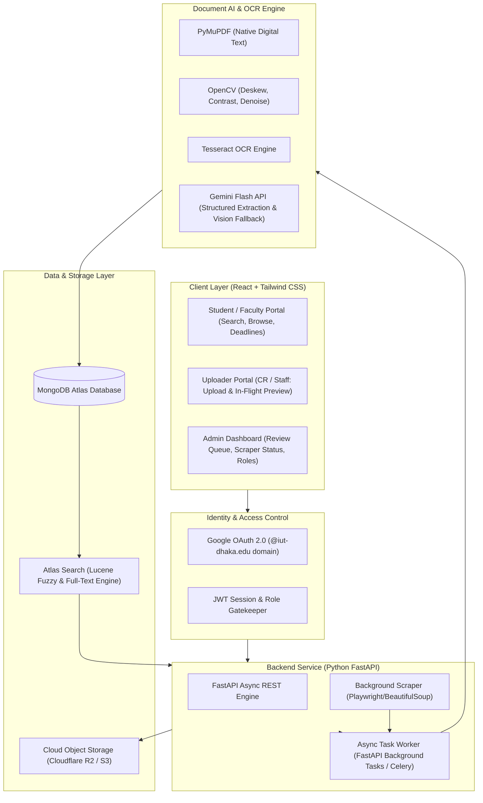
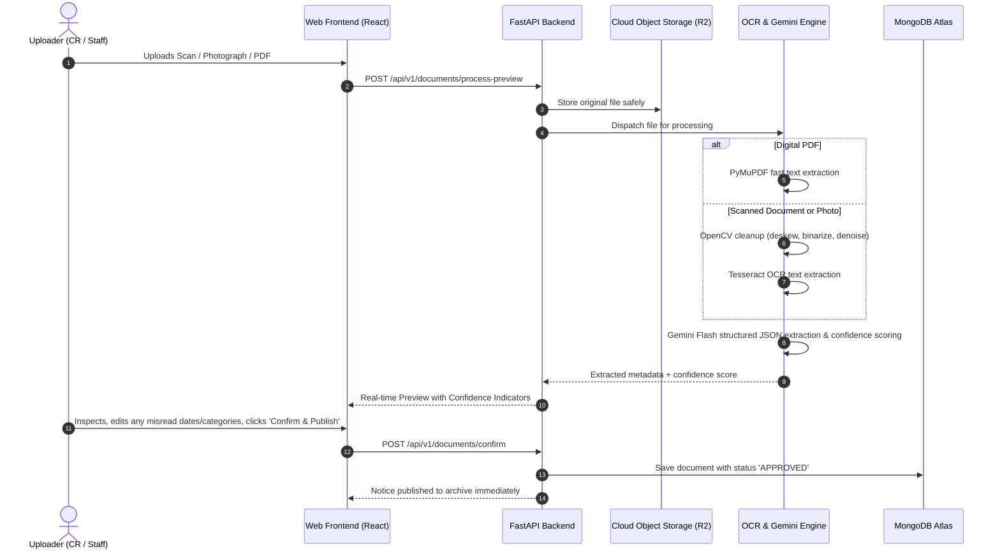
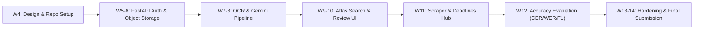

# IRIS: IUT Repository and Information System
## Comprehensive Project Specification & Architecture Plan (DP-I)

**Academic Supervisor:** Imtiaj Ahmed Chowdhury  
**Team 7 (Department of Computer Science and Technology, IUT):**
- Ashfaque Sadad (ID: 230042102)
- Md Rufayed Ul Alam (ID: 230042121)
- MD Zahin Uddin Nirob (ID: 230042160)

---

## 1. Executive Summary & Problem Resolution

Official notices and circulars at the Islamic University of Technology (IUT) are dispersed across notice boards, faculty emails, website updates, and student group chats. Scanned or photographed physical notices are neither text-searchable nor indexed. Furthermore, official notices disappear once archived or removed from the main website.

**IRIS (IUT Repository and Information System)** solves this by establishing an authenticated, AI-augmented, permanent institutional repository. Through a collaborative grilling and design review, all foundational ambiguities from the initial proposal have been systematically resolved:

| Initial Proposal Ambiguity | Resolved Architecture Decision |
| :--- | :--- |
| **Ingestion Scope** | **Hybrid Ingestion**: Manual uploader portal (CRs/Officials) + automated background scraper for `iutoic-dhaka.edu`. |
| **Backend Language Divergence** (Node.js vs. Python Worker) | **Unified Python Backend (FastAPI)**: Eliminates cross-language overhead; integrates API, scraping, OCR, and AI into one high-performance async runtime. |
| **Document Storage Location** | **Cloud Object Storage (S3 / Cloudflare R2 / Supabase Storage)**: Keeps MongoDB lightweight; guarantees permanent, cost-effective file asset hosting. |
| **Confidence & Review Bottleneck** | **In-Flight Uploader Verification + Admin Queue Fallback**: Uploaders preview AI-extracted fields with confidence indicators for immediate sign-off; only unverified low-confidence uploads enter admin review. |
| **Search Engine Strategy** | **MongoDB Atlas Search (Lucene)**: Typo-tolerant fuzzy search over OCR-extracted text, combined with faceted filtering. |
| **OCR Pipeline Strategy** | **Hybrid Pipeline**: PyMuPDF for native PDFs; OpenCV preprocessing + Tesseract OCR for physical notice photos; Gemini API for structured metadata extraction with multimodal fallback. |
| **Access Control & Identity** | **Google OAuth restricted to `@iut-dhaka.edu`**: Automatic role provisioning (Student, CR, Faculty, Admin). |
| **Notice Taxonomy** | **Structured Multi-Dimensional Schema**: Category, Department, Target Audience (Batch/Program), Sender, and Deadlines. |
| **Deadline Utility** | **Interactive Deadline Hub with `.ics` & Google Calendar Export**. |

---

## 2. System Architecture



---

## 3. Data Schema & Metadata Taxonomy

### 3.1 Document Entity Schema
Each notice is indexed with rich structural metadata:

```json
{
  "_id": "ObjectId",
  "title": "Registration Deadline for Winter 2026 Semester",
  "category": "Academic", 
  "subCategory": "Course Registration",
  "department": "All",
  "targetAudience": {
    "programs": ["B.Sc.", "H.D."],
    "batches": ["2022", "2023", "2024", "2025"],
    "halls": ["All"]
  },
  "sender": {
    "office": "Office of the Registrar",
    "signatory": "Prof. Dr. [Registrar Name]",
    "rawSignatureDetected": true
  },
  "publishedDate": "2026-11-20T00:00:00Z",
  "deadlines": [
    {
      "title": "Payment of Semester Fees without Fine",
      "dueDate": "2026-12-05T23:59:59Z",
      "actionRequired": "Pay dues at Comptroller office or online portal"
    }
  ],
  "extractedText": "Full plain text extracted via PyMuPDF or Tesseract OCR...",
  "confidenceScore": 0.94,
  "status": "APPROVED", 
  "sourceType": "MANUAL_UPLOAD", 
  "fileUrl": "https://r2.storage.iris-iut.edu/notices/2026/11/notice_102.pdf",
  "thumbnailUrl": "https://r2.storage.iris-iut.edu/notices/2026/11/notice_102_thumb.webp",
  "uploaderId": "user_ObjectId",
  "verifiedBy": "user_ObjectId",
  "createdAt": "2026-11-22T02:00:00Z",
  "updatedAt": "2026-11-22T02:05:00Z"
}
```

### 3.2 Category Taxonomy
- **Academic**: Exam Schedules, Class Routines, Syllabus Updates, Add/Drop, Makeup Classes.
- **Administrative & Financial**: Tuition & Fee Circulars, Transport Schedules, Smart Card Notices, Dues Deadlines.
- **Residential & Campus Life**: Hall Allocation, Mess Notices, Medical Center, Maintenance, Cafeteria.
- **Opportunities & Events**: Scholarships, Internships/Placements, Cultural/Sports Events, Seminars.
- **Emergency & Holidays**: Weather Alerts, Administrative Holidays, University Closure.

---

## 4. Document Processing & In-Flight Review Pipeline



> [!NOTE]
> If a notice is ingested via the automated website scraper or an uploader chooses to "Queue for Admin", it enters `PENDING_REVIEW` status. Administrators can inspect flagged notices in the Admin Review Queue with visual side-by-side comparison between the original document and extracted fields.

---

## 5. Key System Features

### 5.1 Student & Faculty Experience
- **Atlas-Powered Search**: Instant fuzzy keyword search tolerating typos and OCR errors.
- **Faceted Filters**: Filter by Department, Sender Office, Category, Date Range, and Status.
- **Interactive Deadline Center**:
  - Filter deadlines by user batch or department.
  - **1-Click Calendar Sync**: Download `.ics` file or directly add to Google Calendar.
- **Permanent Archival Viewer**: View rendered original PDF/image side-by-side with OCR text for verification.

### 5.2 Designated Uploader & Admin Experience
- **In-Flight Visual Preview**: Highlight extracted fields with color-coded confidence (Green $\ge 85\%$, Yellow $60-84\%$, Red $< 60\%$).
- **Batch Processing**: Upload multiple pages or multi-page circulars simultaneously.
- **Scraper Monitor**: View the status, frequency, and logs of the automated `iutoic-dhaka.edu` crawler.
- **User Role Management**: Assign CR or Departmental Staff permissions to student accounts.

---

## 6. Evaluation Framework & Quality Metrics (Week 12 Target)

To satisfy academic rigor for DP-I, the system's performance will be evaluated against an annotated test dataset of real IUT notices:

1. **OCR Performance**:
   - **Character Error Rate (CER)** and **Word Error Rate (WER)** across native PDFs, scanned clean documents, and low-light mobile phone photos.
   - Benchmark target: $\text{WER} < 5\%$ for native PDFs, $\text{WER} < 12\%$ for mobile photos after OpenCV preprocessing.
2. **Metadata Extraction Accuracy**:
   - Precision, Recall, and F1-score across 4 core extraction targets:
     - Primary Category Classification
     - Issuing Office / Sender Identification
     - Target Audience / Department Isolation
     - Critical Deadline Date/Time Extraction
   - Target benchmark: $\text{Macro-F1} \ge 0.90$.
3. **Search Retrieval Quality**:
   - Mean Reciprocal Rank (MRR@5) and Normalized Discounted Cumulative Gain (NDCG@5) testing standard queries against known notices.

---

## 7. Refined Implementation Timeline (Weeks 4 – 14)



| Timeline | Phase | Specific Deliverables |
| :--- | :--- | :--- |
| **Week 4** | Requirements & Design | Finalize schemas, repository structure, API contract specifications. |
| **Weeks 5 – 6** | Foundation & Storage | FastAPI setup, Google OAuth (`@iut-dhaka.edu`), Cloudflare R2 file storage, PyMuPDF digital PDF parser. |
| **Weeks 7 – 8** | Computer Vision & AI Pipeline | OpenCV image enhancement, Tesseract OCR integration, Gemini structured prompt engineering and JSON validation. |
| **Weeks 9 – 10** | Search & In-Flight Review UI | React frontend implementation, MongoDB Atlas Search integration, interactive uploader preview component. |
| **Week 11** | Scraping & Deadlines System | Automated IUT website scraper, deadlines dashboard, `.ics` calendar generator. |
| **Week 12** | Evaluation & Tuning | Systematic testing against 50+ real IUT notices; compute CER, WER, and F1 metrics. |
| **Week 13** | Deployment & Documentation | Dockerization, staging deployment on Render/Railway, comprehensive report drafting. |
| **Week 14** | Defense & Final Submission | Final demonstration, supervisor sign-off, codebase and documentation delivery. |
