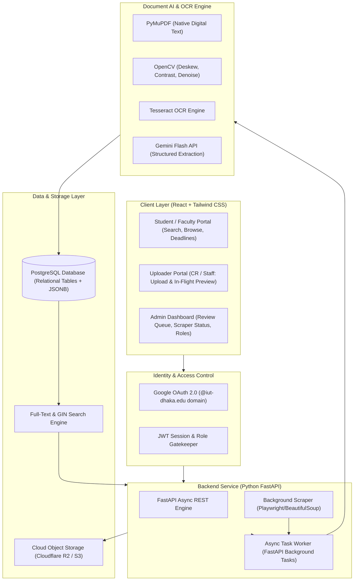
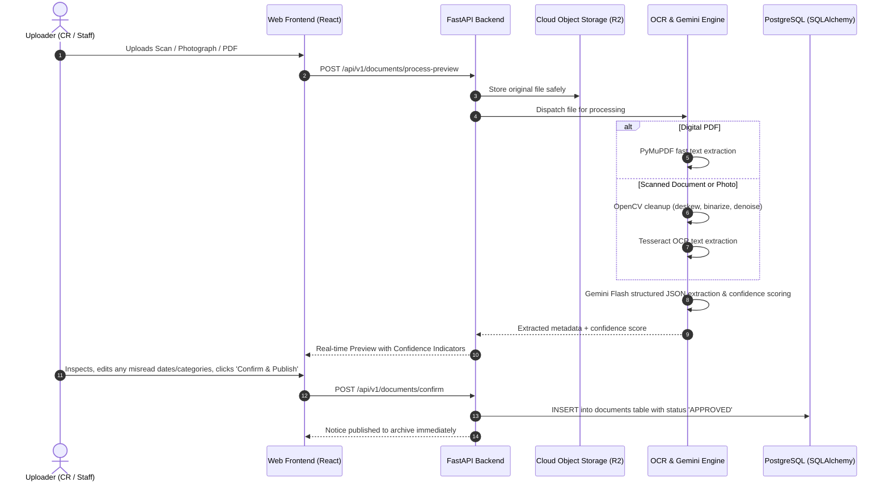

# IRIS: IUT Repository and Information System
## Comprehensive Project Specification & Architecture Plan (DP-I)

**Academic Supervisor:** Imtiaj Ahmed Chowdhury  
**Team 7 (Department of Computer Science and Technology, IUT):**
- Ashfaque Sadad (ID: 230042102)
- Md Rufayed Ul Alam (ID: 230042121)
- MD Zahin Uddin Nirob (ID: 230042160)

---

## 1. Executive Summary & Problem Resolution

Official notices and circulars at the Islamic University of Technology (IUT) are dispersed across notice boards, faculty emails, website updates, and student group chats. Scanned or photographed physical notices are neither text-searchable nor indexed. Furthermore, official notices disappear once archived or removed from the main website.

**IRIS (IUT Repository and Information System)** solves this by establishing an authenticated, AI-augmented, permanent institutional repository. Through architectural reviews and faculty alignment, the system adopts a robust, production-grade **PERN / Modern Python Architecture**:

| Dimension | Resolved Architecture Decision | Justification |
| :--- | :--- | :--- |
| **Backend Framework** | **Unified FastAPI (Python)** | High-performance async REST API natively integrating OpenCV, PyMuPDF, and Gemini without multi-runtime overhead. |
| **Database Engine** | **PostgreSQL (SQLAlchemy + asyncpg)** | Relational integrity for users, roles, departments, and approval logs, paired with native **`JSONB`** for dynamic AI-extracted metadata. |
| **Ingestion Scope** | **Hybrid Ingestion** | Manual uploader portal (CRs/Officials) + scheduled background crawler for `iutoic-dhaka.edu`. |
| **Document Storage** | **Cloud Object Storage (Cloudflare R2 / S3)** | Keeps database lightweight; guarantees permanent, cost-effective raw file asset hosting. |
| **Review Workflow** | **In-Flight Uploader Verification + Admin Queue Fallback** | Uploaders preview AI-extracted fields with color-coded confidence indicators for immediate sign-off; only unverified scraper notices enter admin review. |
| **Search Engine** | **PostgreSQL Full-Text Search (`tsvector`) + Trigram Fuzzy Search** | Fast, typo-tolerant full-text search over OCR text, ready for semantic vector embeddings (`pgvector`). |
| **OCR Pipeline** | **Hybrid Computer Vision & LLM Pipeline** | PyMuPDF for native PDFs; OpenCV preprocessing + Tesseract OCR for physical notice photos; Gemini API for structured metadata extraction. |
| **Access Control** | **Google OAuth restricted to `@iut-dhaka.edu`** | Automatic role provisioning (Student, CR, Faculty, Admin). |
| **Deadlines Utility** | **Interactive Deadline Hub with `.ics` Export** | 1-click sync with Google Calendar and Apple Calendar. |

---

## 2. System Architecture



---

## 3. Relational & JSONB Data Model

### 3.1 Relational Schema Overview
1. **`users` Table**:
   - `id`: UUID (Primary Key)
   - `email`: VARCHAR(255) UNIQUE (restricted to `@iut-dhaka.edu`)
   - `full_name`: VARCHAR(255)
   - `role`: VARCHAR(50) — `STUDENT`, `CR`, `FACULTY`, `OFFICIAL`, `ADMIN`
   - `department`: VARCHAR(100) — e.g. `CSE`, `EEE`, `CEE`, `MPE`, `BTM`
   - `batch`: VARCHAR(50) — e.g. `2023`
   - `is_active`: BOOLEAN
   - `created_at`: TIMESTAMP

2. **`documents` Table**:
   - `id`: UUID (Primary Key)
   - `title`: VARCHAR(500)
   - `category`: VARCHAR(100) — `Academic`, `Administrative & Financial`, `Residential & Campus Life`, etc.
   - `sub_category`: VARCHAR(100)
   - `department`: VARCHAR(100) (Default: `All`)
   - `published_date`: TIMESTAMP
   - `status`: VARCHAR(50) — `APPROVED`, `PENDING_REVIEW`, `REJECTED`
   - `source_type`: VARCHAR(50) — `MANUAL_UPLOAD`, `WEB_SCRAPER`
   - `file_url`: VARCHAR(1000)
   - `thumbnail_url`: VARCHAR(1000)
   - `extracted_text`: TEXT
   - `confidence_score`: FLOAT
   - **`notice_metadata` (JSONB)**: Indexed with a PostgreSQL **GIN index** for dynamic sub-field querying:
     ```json
     {
       "targetAudience": {
         "programs": ["B.Sc.", "H.D."],
         "batches": ["2022", "2023"],
         "halls": ["All"]
       },
       "sender": {
         "office": "Office of the Registrar",
         "signatory": "Prof. Dr. [Name]",
         "rawSignatureDetected": true
       },
       "deadlines": [
         {
           "title": "Semester Fee Payment Without Fine",
           "dueDate": "2026-11-30T23:59:59Z",
           "actionRequired": "Pay dues at Comptroller office"
         }
       ]
     }
     ```
   - `uploader_id`: VARCHAR(255)
   - `verified_by`: VARCHAR(255)
   - `created_at`: TIMESTAMP
   - `updated_at`: TIMESTAMP

---

## 4. Document Processing & In-Flight Review Pipeline



---

## 5. Implementation Roadmap (Weeks 4 – 14)

| Timeline | Phase | Deliverables |
| :--- | :--- | :--- |
| **Week 4** | Requirements & Design | Relational schema, GIN JSONB indices, API contract specifications, repository setup. |
| **Weeks 5 – 6** | Foundation & Storage | FastAPI setup, PostgreSQL models, Google OAuth, Cloudflare R2 file storage, PyMuPDF digital parser. |
| **Weeks 7 – 8** | Computer Vision & AI Pipeline | OpenCV image enhancement, Tesseract OCR integration, Gemini structured prompt engineering and JSON validation. |
| **Weeks 9 – 10** | Search & In-Flight Review UI | React frontend, PostgreSQL full-text search, interactive uploader preview component. |
| **Week 11** | Scraping & Deadlines System | Automated IUT website scraper, deadlines dashboard, `.ics` calendar generator. |
| **Week 12** | Evaluation & Tuning | Systematic testing against 50+ real IUT notices; compute CER, WER, and F1 metrics. |
| **Week 13** | Deployment & Documentation | Dockerization, staging deployment on Render/Railway, comprehensive report drafting. |
| **Week 14** | Defense & Final Submission | Final demonstration, supervisor sign-off, codebase and documentation delivery. |
